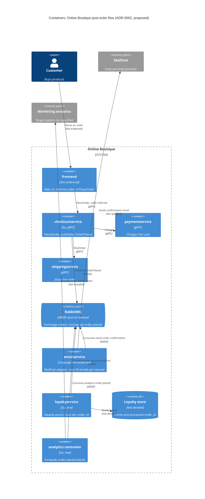

> ร่างโดย agent: Claude Code (ส่วนขยาย VS Code) · model: Claude Opus 5.5 (`claude-opus-5-5`) · แก้ไขและรับรองโดย Thanwarat Korcharoenkiat

# ADR-0002: ใช้ RabbitMQ กระจาย event `OrderPlaced` ให้งานหลังการสั่งซื้อทำงานแบบ asynchronous

- **Status:** Proposed
- **Date:** 2026-10-31
- **Deciders:** ยังไม่ระบุ (ร่างโดย AI agent ให้ทีมพิจารณา ดู **Open questions**)

> **ไฟล์หลักฐาน:** `main.go` คือ `system/online-boutique/src/checkoutservice/main.go`, `scenario.md` คือ `docs/scenario.md` และ ADR-0001 คือ `docs/adr/0001-use-redis-for-cart-storage.md`

## Context and problem

R-12 ใน `scenario.md` กำหนดว่าหลังการสั่งซื้อ ระบบต้อง (1) ส่งอีเมลยืนยันผ่าน **MailFast** ซึ่งเป็น external provider รายใหม่แทน logic จำลองใน `emailservice` (2) ให้แต้ม loyalty ผ่าน `loyaltyservice` ที่จะสร้างใหม่ และ (3) บันทึก analytics event "order placed" ให้ทีม marketing และ marketing คาดว่าปีหน้าจะมีงานหลังการสั่งซื้อเพิ่มอีก (SMS, fraud scoring, อัปเดต recommendations)

**การทำงานในปัจจุบัน**

| ข้อเท็จจริง | หลักฐาน |
|---|---|
| `PlaceOrder` เรียก downstream ทีละตัวแบบ synchronous ผ่าน gRPC: ดึง cart, ดึงราคาสินค้าและแปลงสกุลเงินทีละชิ้น, ขอราคาค่าส่ง แล้วจึง `chargeCard` → `shipOrder` → `emptyUserCart` → `sendOrderConfirmation` | `main.go:288-311` (`prepareOrderItemsAndShippingQuoteFromCart`), `main.go:252-277`; ตรงกับ "How it works today" ใน `scenario.md` |
| การเรียก `emailservice` ใช้ `ctx` ของ request และไม่ตั้ง timeout ของตัวเอง เวลาส่งอีเมลจึงถูกนับรวมใน latency ของ `PlaceOrder` ทั้งหมด | `main.go:273`, `main.go:379-384` (`sendOrderConfirmation`) |
| ถ้าส่งอีเมลไม่สำเร็จ ระบบแค่ `log.Warnf` แล้วตอบว่าสั่งซื้อสำเร็จ ไม่มี retry อีเมลฉบับนั้นจึงหายไป | `main.go:273-279` |
| `checkoutservice` ไม่มี database: struct `checkoutService` เก็บแค่ address กับ gRPC connection; ที่เก็บ order แบบถาวร: Not evidenced in the provided files | `main.go:66-86` |
| `order_id` ถูกสร้างใหม่ทุกครั้งที่เรียก จึงใช้เป็น idempotency key ของงานหลังการสั่งซื้อได้ | `main.go:233` (`uuid.NewUUID()`) |
| ยอดรวม `total` คำนวณใน `PlaceOrder` เป็นสกุลเงินของผู้ใช้ | `main.go:243-250` (`req.UserCurrency`) |
| Tracing ใช้ OpenTelemetry ผ่าน `otelgrpc` ซึ่งครอบคลุมเฉพาะการเรียก gRPC | `main.go:134-140`, `main.go:214-216` |
| Address ของ dependency ตั้งผ่าน env var เช่น `EMAIL_SERVICE_ADDR` | `main.go:111-116` (`mustMapEnv`) |

**ตัวเลขที่กำหนดกรอบการตัดสินใจ** (จาก "Quality goals and constraints" ใน `scenario.md`)

| ประเด็น | ข้อเท็จจริง | ผลต่อการออกแบบ |
|---|---|---|
| Checkout latency | p95 ≤ 500 ms, ปัจจุบัน ~300 ms | งานที่เพิ่มเข้า `PlaceOrder` ใช้เวลารวมได้ราว 200 ms ที่ p95 |
| MailFast latency | p95 1.5 s, p99 8 s | p95 ของ MailFast ตัวเดียวก็เกินงบ 500 ms ทั้งหมดแล้ว จึงเรียก MailFast ภายใน `PlaceOrder` ไม่ได้ |
| Peak เทียบกับ rate limit | 200 orders/s ช่วง 11.11 เทียบกับ 50 emails/s | ต้องการส่ง 4 เท่าของ limit (เกิน 150 ฉบับ/s) จึงต้องมีที่พักอีเมล: backlog เพิ่ม 9,000 ฉบับต่อทุก 1 นาทีของ peak และอีเมลของ order ช่วงท้าย peak จะช้าราว 3 เท่าของความยาวช่วง peak (150 ÷ 50) ไม่ว่าจะเลือกสถาปัตยกรรมแบบใด |
| MailFast ล้มเหลว | ~0.5% ของการเรียก | ต้อง retry: ที่ 50 emails/s คือราว 15 ครั้งต่อนาที |
| Loyalty points | ภายใน 1 นาที, exactly once | event ต้องไม่หายและห้ามให้แต้มซ้ำ; backlog ของอีเมลต้องไม่ทำให้แต้มช้า |
| Availability | order ต้องไม่ล้มเพราะ email, loyalty หรือ analytics ล่ม | ต้องแยก failure ของงานหลังการสั่งซื้อออกจาก `PlaceOrder` |
| Team และ operations | 4 คน ถนัด Go/gRPC, 2 คนเคยใช้ RabbitMQ; ทุกอย่างรันบน Kubernetes; เลือก open-source self-hosted ก่อน cloud-only managed service | จำกัดตัวเลือก infrastructure และความซับซ้อนที่ทีมดูแลไหว |

**ปัญหาที่ต้องตัดสินใจ:** จะต่องานหลังการสั่งซื้อเข้ากับ `PlaceOrder` อย่างไร ให้ checkout ยังเร็วและไม่ล้มตาม ส่งอีเมลได้ภายใต้ rate limit ของ MailFast ให้แต้มครั้งเดียวภายใน 1 นาที และเพิ่มงานใหม่ได้โดยไม่ต้องแก้ `checkoutservice` ทุกครั้ง

## Decision drivers

1. **Availability:** order ต้องสำเร็จแม้ email, loyalty, analytics หรือกลไกใหม่ที่เลือกจะล่ม
2. **Performance:** p95 ของ `PlaceOrder` ≤ 500 ms ที่ 200 orders/s (headroom ราว 200 ms)
3. **Reliability (data integrity):** ให้แต้มภายใน 1 นาที แบบ exactly once (ไม่หาย ไม่ซ้ำ)
4. **Scalability:** รับ 200 orders/s ได้ ทั้งที่ MailFast รับได้ 50 emails/s และล้มเหลว ~0.5%
5. **Modifiability:** เพิ่มงานหลังการสั่งซื้อ (SMS, fraud scoring, recommendations) ได้โดยไม่แก้ `checkoutservice`
6. **Operability และ cost:** ทีม 4 คนดูแลไหวด้วยทักษะ Go, gRPC และ RabbitMQ ที่มี บน Kubernetes แบบ open-source self-hosted

## Considered options

1. **Synchronous gRPC ใน `PlaceOrder`:** ขยายแบบเดิม เรียก `emailservice` (MailFast), `loyaltyservice` และ analytics ต่อจาก `shipOrder` พร้อม timeout และ log เมื่อพลาด
2. **Asynchronous ภายใน process ของ `checkoutservice`:** ตอบผู้ใช้ก่อน แล้วให้ goroutine กับ in-memory queue ทำงานหลังการสั่งซื้อและ retry เอง
3. **Publish/subscribe ผ่าน RabbitMQ (self-hosted):** `checkoutservice` publish event `OrderPlaced` ครั้งเดียว แต่ละงานมี durable queue และ consumer ของตัวเอง
4. **Event log ผ่าน Apache Kafka (self-hosted):** publish `OrderPlaced` ลง topic ที่เก็บ event ไว้ย้อนหลัง แต่ละงานเป็น consumer group ของตัวเอง

ตัด managed cloud messaging ออกตั้งแต่ต้น เพราะ `scenario.md` ระบุว่าบริษัทเลือก open-source self-hosted ก่อน cloud-only managed service

### Pros and cons of the options

| Option | Pros | Cons |
|---|---|---|
| 1. Synchronous gRPC | ง่ายที่สุดและเหมือนโค้ดเดิม (`main.go:273-277`); ทีมถนัด gRPC; ไม่มี infrastructure ใหม่; trace ด้วย `otelgrpc` ได้ทันที | p95 ของ MailFast (1.5 s) เกินงบ 500 ms; ช่วง peak 150 จาก 200 calls/s ชน rate limit; ถ้าตั้ง timeout ให้อยู่ในงบ อีเมลอย่างน้อย 5% (ส่วนที่ช้ากว่า p95) ถูกตัดทิ้ง; พลาดแล้วแค่ log อีเมลและแต้มจึงหาย (ขัด exactly once); งานใหม่ทุกงานต้องแก้และ deploy `checkoutservice` |
| 2. Async ใน process | ไม่เพิ่ม latency; ไม่มี infrastructure ใหม่; เขียนด้วย Go ได้เร็ว | งานที่ค้างใน memory หายเมื่อ pod restart, deploy หรือ scale-in (แต้มหาย); ถ้ามีหลาย replica ต้องแบ่ง rate limit 50/s กันเอง; backlog ช่วง 11.11 สะสมใน memory ของ checkout เสี่ยง OOM จน checkout ล่มเอง (ขัด availability); checkout ยังต้องรู้จักทุกงาน |
| 3. RabbitMQ pub/sub | `PlaceOrder` เพิ่มแค่การ publish ครั้งเดียว; queue พัก backlog ช่วง peak และ consumer คุมอัตราส่งเอง; queue แยกต่องาน backlog อีเมลจึงไม่ถ่วงแต้ม; ack, retry และ DLQ รายข้อความ; งานใหม่แค่ bind queue ใหม่; open-source รันบน Kubernetes; มี 2 คนในทีมเคยใช้ | ต้องดูแล stateful cluster ใหม่; delivery แบบ at-least-once ทำให้ consumer ต้อง idempotent; eventual consistency; ถ้า broker ล่มตอน publish event อาจหาย (dual write) เพราะ checkout ไม่มี database สำหรับ outbox; ต้องส่ง trace context ผ่าน message header เอง; ต้องดูแล schema ของ event |
| 4. Kafka event log | เก็บ event ย้อนหลัง consumer ใหม่ (recommendations, fraud scoring) จึง replay ได้; throughput สูง; เรียงลำดับตาม partition key | `scenario.md` ระบุประสบการณ์ของทีมเฉพาะ RabbitMQ; operate หนักกว่า (partition, retention, replication) ทั้งที่โหลดแค่ 200 msg/s; retry, DLQ และ rate limit รายข้อความสำหรับ MailFast ต้องสร้างเอง; exactly-once ของ Kafka ไม่ครอบคลุม side effect ภายนอก (MailFast, loyalty DB) จึงยังต้องทำ idempotent consumer อยู่ดี |

## Decision

เลือก **Option 3: publish event `OrderPlaced` ไปยัง RabbitMQ ที่รันเองบน Kubernetes** และให้งานหลังการสั่งซื้อแต่ละงานเป็น consumer อิสระ

- **`checkoutservice`:** หลัง `shipOrder` สำเร็จและสร้าง `orderResult` แล้ว (`main.go:258-271`) ให้ publish `OrderPlaced` หนึ่งครั้งแทนการเรียก `sendOrderConfirmation` (`main.go:273-277`) และเลิกเรียก `emailservice` โดยตรง (`EMAIL_SERVICE_ADDR`, `main.go:115`)
  - publish เป็นขั้นตอนสุดท้ายหลังตัดเงินและส่งของสำเร็จ จึงไม่มี event ของ order ที่ล้มเหลว
  - ส่งแบบ persistent ไปที่ topic exchange `orders` (routing key `order.placed`) และรอ publisher confirm ภายใน deadline สั้นที่อยู่ในงบราว 200 ms (ค่าจริงกำหนดจาก load test)
  - ถ้า publish ไม่สำเร็จ **ห้ามทำให้ order ล้ม**: log event ทั้งก้อนเป็น ERROR ทันที (log เป็น JSON อยู่แล้ว, `main.go:52-64`), เก็บไว้ใน retry buffer ขนาดจำกัด และส่ง metric/alert; publish ซ้ำได้อย่างปลอดภัยเพราะ consumer dedup ด้วย `order_id`
  - ตั้ง address ของ broker ผ่าน env var แบบเดียวกับ dependency อื่น (`mustMapEnv`, `main.go:111-116`)
- **Event `OrderPlaced`** (Protobuf แบบเดียวกับ contract gRPC เดิม, `main.go:34`): `order_id` (`main.go:233`), `user_id`, `email`, `OrderResult` (`main.go:265-271`), `total` พร้อมสกุลเงิน (`main.go:243-250`), เวลาที่สั่ง และ `schema_version`; เนื่องจากไม่มี order database ให้ consumer ดึงข้อมูลเพิ่ม event จึงต้องพกข้อมูลที่ทุกงานใช้; แก้ schema ด้วยการเพิ่ม field เท่านั้น
- **Queue:** quorum queue แบบ durable หนึ่ง queue ต่อหนึ่งงาน bind กับ `order.placed` ได้แก่ `email.order-confirmation`, `loyalty.award-points` และ `analytics.order-placed`; ทุก queue มี retry แบบ backoff และ dead-letter queue (DLQ)
- **`emailservice` เป็น MailFast adapter:** consume queue อีเมล, จำกัดอัตรารวมทุก replica ≤ 50 emails/s (rate limiter ฝั่ง consumer ร่วมกับ prefetch), ส่งแบบ concurrent (ถ้าเวลาเฉลี่ยใกล้ p95 ต้องมีคำขอค้างพร้อมกันราว 50 × 1.5 s ≈ 75 รายการ **[Inferred]** เพราะ `scenario.md` ไม่ให้ค่าเฉลี่ย), ตั้ง timeout มากกว่า p99 (8 s) เพื่อลดอีเมลซ้ำจากการ retry และ ack หลัง MailFast รับเรื่องแล้วเท่านั้น
- **`loyaltyservice` (Go, ใหม่):** ใน transaction เดียว บันทึก `order_id` ลงตารางที่มี unique constraint และเพิ่มแต้ม แล้ว commit ก่อน ack; ถ้าเจอ `order_id` ซ้ำให้ ack โดยไม่ให้แต้ม (at-least-once delivery + idempotent consumer = แต้มครั้งเดียว); มี queue ของตัวเองจึงไม่ติด backlog อีเมล
- **Analytics consumer (Go, ใหม่):** ส่ง event ไประบบ analytics ของ marketing (ไม่ได้ระบุใน `scenario.md`), dedup ด้วย `order_id` และตัดข้อมูลส่วนบุคคลที่ไม่ใช้ทิ้ง
- **RabbitMQ:** cluster 3 nodes บน Kubernetes เดิม เพื่อให้ quorum queue ทนการล่มได้ 1 node; ติดตาม queue depth, อายุข้อความที่เก่าที่สุด, ขนาด DLQ และ publish failure; ผู้ดูแลและ on-call คือนักพัฒนา 2 คนในทีมที่เคยใช้ RabbitMQ
- **งานในอนาคต** (SMS, recommendations และ fraud scoring ถ้าไม่ต้องบล็อก order): เพิ่ม queue และ consumer ใหม่ที่ bind กับ `order.placed` โดยไม่แก้ `checkoutservice`

**เหตุผล:** Option 1 ไม่ผ่าน driver 2–5 และ Option 2 ไม่ผ่าน driver 3 กับ 5 (และเสี่ยงต่อ driver 1 เมื่อ backlog สะสมใน memory) ส่วน Option 3 และ 4 ผ่าน driver 1–5 ทั้งคู่ เพราะเอา MailFast ออกจาก critical path, แยก failure, พัก backlog, ทำ exactly once ด้วย idempotent consumer และเพิ่ม consumer ใหม่ได้ ระหว่างสองตัวนี้เลือก RabbitMQ ตาม driver 6 เพราะทีมมีคนเคยใช้ และงานนี้เป็น task queue ที่ต้อง ack, retry และคุมอัตรารายข้อความ ขณะที่ความสามารถ replay ของ Kafka ยังไม่ใช่ข้อกำหนดของ R-12 Trade-off ที่ยอมรับคือ มี infrastructure ใหม่ต้องดูแลและข้อมูลเป็น eventual consistency เพื่อแลกกับ availability, performance และ modifiability

แผนภาพแสดงเฉพาะ container ที่เกี่ยวกับการตัดสินใจนี้ (ไม่แสดง service ของ cart, product catalog และ currency ที่ `PlaceOrder` เรียกก่อนตัดเงิน)

## Consequences

- **Positive:** latency ของ MailFast (p95 1.5 s, p99 8 s) ออกจาก critical path; `PlaceOrder` เพิ่มแค่การ publish หนึ่งครั้งและไม่ต้องรอ `emailservice` อีก (quality attribute: performance)
- **Positive:** เมื่อ MailFast, `loyaltyservice` หรือ analytics ล่ม order ยังสำเร็จ และข้อความรออยู่ใน queue จนกว่าระบบจะกลับมา (quality attribute: availability)
- **Positive:** queue รับ burst 200 orders/s ช่วง 11.11 ได้ และส่งอีเมลไม่เกิน 50/s จึงไม่ชน rate limit (quality attribute: scalability)
- **Positive:** แต่ละ `order_id` ได้แต้มครั้งเดียวแม้ข้อความถูกส่งซ้ำ (quality attribute: reliability)
- **Positive:** เพิ่มงานหลังการสั่งซื้อได้ด้วย consumer ใหม่ โดยไม่ต้องแก้หรือ deploy `checkoutservice` (quality attribute: modifiability)
- **Negative:** มี stateful component ใหม่ที่ทีม 4 คนต้องดูแล (upgrade, backup, monitoring, on-call) และต้องสร้าง analytics consumer กับปรับ `emailservice` เพิ่ม (quality attribute: operability, cost)
- **Negative:** ช่วง peak อีเมลยืนยันถึงลูกค้าช้า (ราว 3 เท่าของความยาวช่วง peak สำหรับ order ช่วงท้าย) เพราะ rate limit ของ MailFast (quality attribute: performance ของการส่งอีเมลแบบ end-to-end)
- **Negative:** at-least-once อาจทำให้ลูกค้าได้อีเมลยืนยันซ้ำ ถ้า MailFast ไม่รองรับ idempotency key (quality attribute: reliability, usability)
- **Negative:** debug ยากขึ้นเพราะ flow เป็น asynchronous และต้อง inject/extract trace context ใน message header เอง เพราะ `otelgrpc` ครอบคลุมแค่ gRPC (`main.go:134-140`) (quality attribute: observability, testability)
- **Negative:** event `OrderPlaced` กลายเป็น contract ที่หลาย consumer พึ่งพา และมีข้อมูลส่วนบุคคล (email, ที่อยู่) อยู่ใน broker (quality attribute: modifiability, security)
- **Risks and mitigations:**
  - *broker ล่มตอน publish แล้ว pod ตายก่อน retry สำเร็จ event จึงหาย (dual write) เพราะ checkout ไม่มี database สำหรับ transactional outbox (`main.go:66-86`):* ใช้ cluster 3 nodes, publisher confirm, retry buffer, drain buffer เมื่อ pod ได้รับ SIGTERM และ log event ทั้งก้อนไว้ replay; ถ้ายอมให้หายไม่ได้ ให้ออก ADR ใหม่เรื่อง transactional outbox (ต้องเพิ่ม datastore ให้ checkout)
  - *publish ช้าจน p95 เกิน 500 ms:* ใช้ deadline ของ publish และ load test ก่อนใช้งานจริง
  - *`loyaltyservice` ประมวลผลไม่ทัน 200 msg/s จนเกิน 1 นาที:* scale consumer ได้เพราะ idempotent และ alert เมื่ออายุข้อความเก่าสุดใกล้ 60 s; ถ้า `loyaltyservice` หรือ broker ล่มนานกว่า 1 นาที แต้มจะไม่หายแต่จะช้ากว่าเป้า
  - *backlog อีเมลช่วง peak ทำ disk ของ broker เต็ม:* เตรียม disk ให้พอสำหรับ 150 × (ความยาว peak เป็นวินาที) ข้อความ, alert ที่ queue depth และขอเพิ่ม rate limit กับ MailFast
  - *poison message วนไม่จบ:* จำกัดจำนวน retry แล้วย้ายไป DLQ พร้อม alert
  - *ประสบการณ์ operate RabbitMQ ของทีมไม่ระบุ (`scenario.md` บอกแค่ว่า 2 คนเคยใช้):* ให้ 2 คนนี้เป็นผู้นำ, ใช้ Kubernetes operator และเขียน runbook
  - *ผู้เรียก retry `PlaceOrder` แล้วได้ `order_id` ใหม่ (`main.go:233`) ทำให้ตัดเงินและให้แต้มซ้ำ ซึ่ง dedup ด้วย `order_id` กันไม่ได้ (เดิมเป็น Open question ข้อ 8):* ให้ผู้เรียกส่ง idempotency key มากับ PlaceOrder และใช้แทน order_id ที่สร้างใหม่ทุกครั้ง

## Validation

- **Load test** ด้วย Locust `loadgenerator` (แบบเดียวกับ ADR-0001) ที่ 200 orders/s โดยใช้ MailFast stub ที่จำลอง p95 1.5 s, p99 8 s, ล้มเหลว 0.5% และ rate limit 50/s: p95 ของ `PlaceOrder` ต้อง ≤ 500 ms (เทียบกับ ~300 ms ก่อนเปลี่ยน)
- **Loyalty:** ระหว่าง load test อายุข้อความที่เก่าที่สุดใน `loyalty.award-points` ต้อง < 60 s; จำนวน `order_id` ที่ได้แต้มเท่ากับจำนวน order ที่สำเร็จ และไม่มี `order_id` ใดได้แต้มเกิน 1 ครั้ง แม้บังคับให้ส่งซ้ำ (kill consumer ก่อน ack, publish ซ้ำ)
- **Failure injection:** หยุด MailFast stub, `loyaltyservice`, analytics consumer และ RabbitMQ 1 node ระหว่าง load test: ต้องไม่มี `PlaceOrder` ที่ล้มเพราะสิ่งเหล่านี้ และทุกข้อความถูกประมวลผลครบหลังระบบกลับมา
- **MailFast:** อัตราส่งไม่เกิน 50/s (ไม่มี rate-limit error) และ DLQ ว่างหรืออธิบายได้ทุกข้อความ
- **Review:** ทบทวน ADR นี้หลัง 11.11 ครั้งถัดไปด้วยตัวเลขจริง หรือก่อนเพิ่มงานหลังการสั่งซื้องานแรกของปีหน้า

## Open questions

| # | คำถาม | ทำไมสำคัญ |
|---|---|---|
| 1 | ช่วง peak 11.11 ยาวเท่าไร, อัตรา order นอกช่วง peak เป็นเท่าไร และ event มีขนาดเท่าไร | ใช้คำนวณ backlog อีเมล (150 ฉบับ/s × ความยาว peak), เวลาที่ใช้ระบาย backlog และขนาด disk ของ broker |
| 2 | อีเมลยืนยันช้าได้มากที่สุดเท่าไร; MailFast เพิ่ม rate limit หรือส่งแบบ batch ได้ไหม | ช่วงท้าย peak อีเมลจะช้าราว 3 เท่าของความยาว peak; ถ้าธุรกิจรับไม่ได้ ต้องแก้ที่สัญญากับ MailFast ไม่ใช่ที่สถาปัตยกรรม |
| 3 | MailFast API ใช้ protocol อะไร, รองรับ idempotency key ไหม, error แบบไหน retry ได้ และ latency เฉลี่ยเท่าไร | ใช้กำหนด timeout, concurrency และโอกาสที่ลูกค้าจะได้อีเมลซ้ำ |
| 4 | ถ้า broker ล่มทั้ง cluster ยอมให้ event ของ order ช่วงนั้นหาย (ไม่มีอีเมล แต้ม และ analytics) ได้ไหม; มีแผนสร้าง order database หรือไม่ | ถ้ายอมไม่ได้ ต้องทำ transactional outbox ซึ่งต้องมี datastore ใน `checkoutservice` (วันนี้ไม่มี, `main.go:66-86`) |
| 5 | กติกาแต้ม: ได้กี่แต้มต่อยอดเท่าไร คิดจากสกุลเงินไหน และต้องหักแต้มคืนเมื่อยกเลิกหรือคืนเงินไหม; `loyaltyservice` ใช้ datastore อะไร | `total` เป็นสกุลเงินของผู้ใช้ (`main.go:243`); การหักแต้มคืนต้องมี event เพิ่ม |
| 6 | ระบบ analytics ปลายทางคืออะไร ต้องการข้อมูลสดแค่ไหน เก็บข้อมูลส่วนบุคคลได้ไหม และต้อง replay ย้อนหลังไหม | ถ้าต้อง replay อาจต้องใช้ RabbitMQ Streams หรือ Kafka และต้องทบทวน ADR นี้ |
| 7 | fraud scoring ต้องบล็อกหรือยกเลิก order ได้ไหม | ถ้าได้ จะทำหลังการสั่งซื้อแบบ asynchronous ไม่ได้ ต้องทำก่อน `chargeCard` (`main.go:252`) หรือมี compensation flow |
| 9 | ควรดัดแปลง `emailservice` เดิมหรือเขียนใหม่ด้วย Go | โค้ดของ `emailservice` ไม่อยู่ในไฟล์ที่ให้มา |
| 10 | R-12 ต้องใช้งานได้ก่อน 11.11 ครั้งถัดไปหรือไม่ | ทีมมี 4 คน และ ADR นี้ลงวันที่ 2026-10-31 |
| 11 | ใครเป็น Deciders ของ ADR นี้ | ไม่ระบุใน context |
