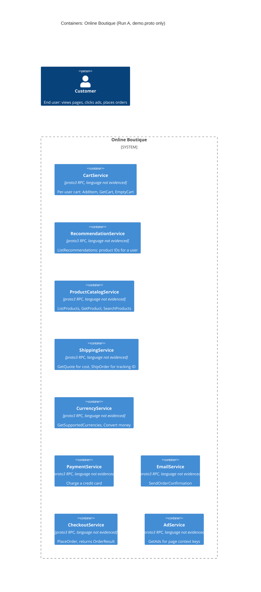

# Task 1 · Run A: Recovered container architecture

**Evidence (only):** `system/online-boutique/protos/demo.proto`
**Labels:** unlabelled = shown in the evidence (path and line given) · **[Inferred]** = plausible reading that the evidence does not prove · *Not evidenced* = not evidenced in the provided files.

## 1. Agent

- **Product:** Claude Code (Anthropic), VS Code extension
- **Model:** Claude Opus 5.5 (`claude-opus-5-5`)

## 2. Files read

| File | Used for |
|---|---|
| `prompts/1-recover-architecture.md` | Task instructions |
| `system/online-boutique/protos/demo.proto` | The only evidence for every claim below |

`CLAUDE.md` and `AGENTS.md` were loaded automatically by Claude Code as agent rules; they were not used as evidence. No other file was opened, listed or searched, and no terminal command was run.

## 3. Containers table

| Name | Technology / language | Responsibility (from its RPCs) | Evidence |
|---|---|---|---|
| CartService | proto3 RPC · language *Not evidenced* | Keeps a cart per `user_id`: `AddItem`, `GetCart`, `EmptyCart` | `system/online-boutique/protos/demo.proto:23-27` (`service CartService`); messages 29-50 |
| RecommendationService | proto3 RPC · language *Not evidenced* | Returns recommended `product_ids` for a `user_id` and a list of `product_ids`: `ListRecommendations` | `system/online-boutique/protos/demo.proto:56-58` (`service RecommendationService`); messages 60-67 |
| ProductCatalogService | proto3 RPC · language *Not evidenced* | Serves products (id, name, description, picture, `price_usd`, categories): `ListProducts`, `GetProduct`, `SearchProducts` | `system/online-boutique/protos/demo.proto:71-75` (`service ProductCatalogService`); `Product` 77-87 |
| ShippingService | proto3 RPC · language *Not evidenced* | Quotes shipping for an `Address` + items (`GetQuote` → `cost_usd`) and ships them (`ShipOrder` → `tracking_id`) | `system/online-boutique/protos/demo.proto:107-110` (`service ShippingService`); messages 112-136 |
| CurrencyService | proto3 RPC · language *Not evidenced* | Lists supported ISO 4217 currency codes (`GetSupportedCurrencies`) and converts `Money` into another currency (`Convert`) | `system/online-boutique/protos/demo.proto:140-143` (`service CurrencyService`); messages 146-173 |
| PaymentService | proto3 RPC · language *Not evidenced* | Charges a credit card for an amount and returns a `transaction_id`: `Charge` | `system/online-boutique/protos/demo.proto:177-179` (`service PaymentService`); messages 181-195 |
| EmailService | proto3 RPC · language *Not evidenced* | Sends an order confirmation to an e-mail address, given an `OrderResult`: `SendOrderConfirmation` | `system/online-boutique/protos/demo.proto:199-201` (`service EmailService`); messages 203-219 |
| CheckoutService | proto3 RPC · language *Not evidenced* | Places an order from user ID, currency, address, e-mail and credit card; returns an `OrderResult` (order ID, shipping tracking ID, shipping cost, items): `PlaceOrder` | `system/online-boutique/protos/demo.proto:224-226` (`service CheckoutService`); messages 228-239 |
| AdService | proto3 RPC · language *Not evidenced* | Returns text ads with a redirect URL for keywords from the current page: `GetAds` | `system/online-boutique/protos/demo.proto:243-245` (`service AdService`); messages 247-262 |

- **What a row really is:** a proto3 `service` in package `hipstershop` (lines 15, 17). One container per `service` is **[Inferred]**: each service has its own section header (e.g. line 21 `Cart service`) and the Go import path names the repository `microservices-demo` (line 19), but the file defines interfaces, not deployment units.
- **Protocol:** the file never names a transport. gRPC is the standard transport for proto3 `service`/`rpc` definitions, so gRPC is **[Inferred]**. All 15 RPCs are unary (no `stream`): request/response only; no asynchronous messaging is defined.
- **Language:** *Not evidenced* for any service. `option go_package` (line 19) only shows that Go code is generated from this file.
- **Data stores:** none evidenced; the file defines no database, cache or queue (see G4).
- **End user** (the diagram's `Person`; not a container): a customer. Evidence: the comments "key words from the current page" (line 248) and "url to redirect to when an ad is clicked" (line 257); `PlaceOrderRequest` carries the user's address, e-mail and credit card (lines 228-235).

## 4. Dependencies table

| Caller → callee | Protocol | Evidence |
|---|---|---|
| *None evidenced* | — | `system/online-boutique/protos/demo.proto` declares only the server side of 9 services; no message, field, option or comment names a caller. |

- **Evidenced instead: schema coupling (compile-time, not runtime).** All 9 interfaces share one package and reuse each other's message types: `Money` (line 146) appears in 6 of the 9 interfaces, `CartItem` (29) in 4, `Address` (130) in 3; `CreditCardInfo` (181) is shared by CheckoutService and PaymentService, `OrderResult` (208) by CheckoutService and EmailService. This is not a runtime call, so it is not in the diagram.
- The runtime dependencies these shared types suggest are listed under **Gaps → G1**.

## 5. Mermaid diagram

Matches the tables exactly: 9 `Container`s, no `ContainerDb`/`ContainerQueue`, no `System_Ext`, and **no `Rel`**, because section 4 has no evidenced dependency. The `Person` has no `Rel` because no entry point is evidenced (G2).

## 6. Gaps

| # | Could not determine | Hint in `demo.proto` | File that would settle it |
|---|---|---|---|
| G1 | **Every runtime dependency** (who calls whom) | Shared message types only; see candidates below | Deployment manifests in `system/online-boutique/kubernetes-manifests/` (service-address environment variables; folder named in `AGENTS.md`, not opened), or each service's client code |
| G2 | **The user entry point**: a UI / front-end container, its technology, and the protocol the `Person` uses | "current page" (248), "ad is clicked" (257) and `Product.picture` (81) imply a page-based UI **[Inferred]**, but no `service` declares one | The manifests (a UI deployment and how it is exposed) and that UI's source |
| G3 | **Language / runtime** of each service | `option go_package` (19): Go code is generated, so at least one component is Go **[Inferred]**; which one is unknown | Each service's source code or Dockerfile (location not shown in the evidence); container image names in the manifests |
| G4 | **Data stores** | `CartService` must keep state between `AddItem` and `GetCart` (24-25), but where is *Not evidenced*; the same holds for product data (71-75) and ads (243-245). No RPC reads an order back (only `PlaceOrder`, 225), so no order store is evidenced | `CartService` source/config; the manifests (a database deployment and its connection setting) |
| G5 | **External systems** | `Charge` (178), `SendOrderConfirmation` (200) and `ShipOrder` (109) may call a card processor, mail server or carrier **[Inferred]**; none is named. `Ad.redirect_url` (258) is a link for the user, not a service call | Source and config of PaymentService, EmailService and ShippingService |
| G6 | **Transport and deployment** | gRPC **[Inferred]** from proto3 `service`/`rpc`; one container per `service` **[Inferred]** (line 19, section headers); ports and replica counts *Not evidenced* | The manifests (container ports, Kubernetes Services); each server's start-up code |
| G7 | **Containers with no RPC interface** (UI, batch jobs, data stores, pure clients) | Such containers cannot appear in a `.proto` file at all | Full listing of `system/online-boutique/kubernetes-manifests/` |

### G1 candidates: inferred runtime dependencies (kept out of the diagram)

All would use the RPCs above (gRPC **[Inferred]**). Line numbers refer to `system/online-boutique/protos/demo.proto`.

| Candidate caller → callee (RPC) | Hint | Strength |
|---|---|---|
| CheckoutService → PaymentService (`Charge`) | `PlaceOrderRequest.credit_card` (234) is the same `CreditCardInfo` that `ChargeRequest` needs (190) | Strong |
| CheckoutService → EmailService (`SendOrderConfirmation`) | `PlaceOrderRequest.email` (233) + `PlaceOrderResponse.order` (238) are exactly `SendOrderConfirmationRequest` {`email`, `order`} (217-218) | Strong |
| CheckoutService → ShippingService (`GetQuote`, `ShipOrder`) | `OrderResult.shipping_tracking_id` / `shipping_cost` (210-211) mirror `ShipOrderResponse.tracking_id` (127) / `GetQuoteResponse.cost_usd` (118) | Strong |
| CheckoutService → CartService (`GetCart`, possibly `EmptyCart`) | `PlaceOrderRequest` (228-235) has a `user_id` but no items; the only per-user item list in the file is `Cart` (47-50) | Medium |
| CheckoutService → ProductCatalogService (`GetProduct`) | `OrderItem.cost` (205) needs a price; `CartItem` has only `product_id` and `quantity` (30-31); the only price in the file is `Product.price_usd` (82) | Medium |
| CheckoutService → CurrencyService (`Convert`) | `PlaceOrderRequest.user_currency` (230) vs. USD amounts `price_usd` (82) and `cost_usd` (118) | Medium |
| RecommendationService → ProductCatalogService | Returns other `product_ids` (66); `Product.categories` "can be used to look up other related products" (84-86) | Weak |
| Undeclared UI client → AdService, ProductCatalogService, CartService, CheckoutService (possibly RecommendationService, CurrencyService) | These RPCs take page or user input: `GetAds.context_keys` from "the current page" (248-249), `SearchProducts.query` (98), `AddItem` (24), `PlaceOrder` with the user's card (225, 234); see G2 | Medium that a UI exists; weak for the exact edges |
