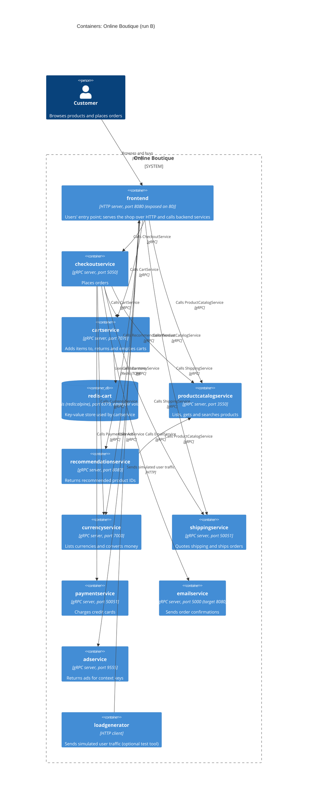

# Task 1, run B: C4 container architecture of Online Boutique

- **Run:** B
- **Evidence:** `system/online-boutique/protos/demo.proto`, `system/online-boutique/kubernetes-manifests/`
- In §3–§6, paths are relative to `system/online-boutique/` and `Lnn` gives line numbers.

## 1. Agent

Claude Code (Anthropic), VS Code extension. Model: Claude Opus 5.5 (`claude-opus-5-5`).

## 2. Files read

Evidence:

- `system/online-boutique/protos/demo.proto`
- `system/online-boutique/kubernetes-manifests/kustomization.yaml`
- `system/online-boutique/kubernetes-manifests/README.md`
- `system/online-boutique/kubernetes-manifests/adservice.yaml`
- `system/online-boutique/kubernetes-manifests/cartservice.yaml`
- `system/online-boutique/kubernetes-manifests/checkoutservice.yaml`
- `system/online-boutique/kubernetes-manifests/currencyservice.yaml`
- `system/online-boutique/kubernetes-manifests/emailservice.yaml`
- `system/online-boutique/kubernetes-manifests/frontend.yaml`
- `system/online-boutique/kubernetes-manifests/loadgenerator.yaml`
- `system/online-boutique/kubernetes-manifests/paymentservice.yaml`
- `system/online-boutique/kubernetes-manifests/productcatalogservice.yaml`
- `system/online-boutique/kubernetes-manifests/recommendationservice.yaml`
- `system/online-boutique/kubernetes-manifests/shippingservice.yaml`

Instructions, not used as evidence: `prompts/1-recover-architecture.md` (the task file), plus `AGENTS.md` and `CLAUDE.md` (loaded automatically by Claude Code).

Tried but not opened:

- `system/online-boutique/kubernetes-manifests/` itself. A folder can't be listed without a terminal command, so I found the manifests through `kustomization.yaml` (its `resources` plus the commented-out `loadgenerator.yaml`).
- `system/online-boutique/kubernetes-manifests/shoppingassistantservice.yaml`. It does not exist; I checked because `frontend.yaml` sets `SHOPPING_ASSISTANT_SERVICE_ADDR`.

## 3. Containers table

- **Language/runtime: Not evidenced in the provided files** for any service. The manifests use placeholder images (`image: frontend`, `image: cartservice`, …) that skaffold fills in (`kubernetes-manifests/README.md` L3–5). So the Technology column gives what the manifests do show: protocol and port.
- gRPC is shown by the manifests: each Service's port is named `grpc`, and its pods use `grpc:` readiness/liveness probes. `demo.proto` gives each service's API.
- Each Deployment is matched to the `demo.proto` service of the same name (`cartservice` ↔ `CartService`, …). No provided file states this mapping **[Inferred]**.

| # | Container | C4 element | Technology | Responsibility | Evidence |
|---|---|---|---|---|---|
| 1 | `frontend` | `Container` | HTTP server, port 8080 (exposed on 80) | Users' entry point and the only container exposed outside the cluster. Serves the shop over HTTP with session cookie `shop_session-id`; calls 7 backend services (§4) | `kubernetes-manifests/frontend.yaml`: Service `frontend-external`, `type: LoadBalancer`, port `http` 80→8080 (L123–136); `httpGet /_healthz` probes with the `shop_session-id` cookie (L50–65); `*_SERVICE_ADDR` env (L69–84) |
| 2 | `checkoutservice` | `Container` | gRPC server, port 5050 | Places an order (`PlaceOrder`): takes user ID, currency, address, email and credit card, and returns an `OrderResult` (order ID, tracking ID, shipping cost, items). Calls 6 services (§4) | `protos/demo.proto` `CheckoutService` (L224–239), `OrderResult` (L208–214); `kubernetes-manifests/checkoutservice.yaml`: `grpc` probes (L48–53), Service port `grpc` 5050 (L87–90) |
| 3 | `cartservice` | `Container` | gRPC server, port 7070 | Adds items to, returns and empties a user's cart (`AddItem`, `GetCart`, `EmptyCart`) | `protos/demo.proto` `CartService` (L23–27); `kubernetes-manifests/cartservice.yaml`: `grpc` probes (L59–67), Service port `grpc` 7070 (L79–82) |
| 4 | `redis-cart` | `ContainerDb` | Redis (`redis:alpine`), port 6379, `emptyDir` volume | Key-value store used by `cartservice`. Holds the cart contents **[Inferred]** from its name and `CartService`. Data sits in an `emptyDir` volume, so it does not outlive the pod | `kubernetes-manifests/cartservice.yaml`: Deployment `redis-cart`, `image: redis:alpine` (L89–118), volume `redis-data` (`emptyDir`) mounted at `/data` (L129–141), Service port `tcp-redis` 6379 (L143–156) |
| 5 | `productcatalogservice` | `Container` | gRPC server, port 3550 | Lists, gets and searches products (`ListProducts`, `GetProduct`, `SearchProducts`) | `protos/demo.proto` `ProductCatalogService` (L71–103); `kubernetes-manifests/productcatalogservice.yaml`: `grpc` probes (L54–59), Service port `grpc` 3550 (L78–81) |
| 6 | `recommendationservice` | `Container` | gRPC server, port 8080 | Returns recommended product IDs for a user and a list of product IDs (`ListRecommendations`). Calls `productcatalogservice` | `protos/demo.proto` `RecommendationService` (L56–67); `kubernetes-manifests/recommendationservice.yaml`: `grpc` probes (L49–56), Service port `grpc` 8080 (L82–85) |
| 7 | `currencyservice` | `Container` | gRPC server, port 7000 | Lists supported currencies and converts `Money` amounts between them (`GetSupportedCurrencies`, `Convert`) | `protos/demo.proto` `CurrencyService` (L140–173); `kubernetes-manifests/currencyservice.yaml`: `grpc` probes (L55–60), Service port `grpc` 7000 (L79–82) |
| 8 | `shippingservice` | `Container` | gRPC server, port 50051 | Quotes the shipping cost for items to an address, and ships them with a tracking ID (`GetQuote`, `ShipOrder`) | `protos/demo.proto` `ShippingService` (L107–128); `kubernetes-manifests/shippingservice.yaml`: `grpc` probes (L53–59), Service port `grpc` 50051 (L78–81) |
| 9 | `paymentservice` | `Container` | gRPC server, port 50051 | Charges an amount to a credit card and returns a transaction ID (`Charge`) | `protos/demo.proto` `PaymentService` (L177–195); `kubernetes-manifests/paymentservice.yaml`: `grpc` probes (L54–59), Service port `grpc` 50051 (L78–81) |
| 10 | `emailservice` | `Container` | gRPC server, port 5000 (target 8080) | Sends the confirmation for an `OrderResult` to an email address (`SendOrderConfirmation`) | `protos/demo.proto` `EmailService` (L199–219); `kubernetes-manifests/emailservice.yaml`: `grpc` probes on 8080 (L54–61), Service port `grpc` 5000 → `targetPort` 8080 (L80–83) |
| 11 | `adservice` | `Container` | gRPC server, port 9555 | Returns text ads (`text`, `redirect_url`) for a page's context keys (`GetAds`) | `protos/demo.proto` `AdService` (L243–262); `kubernetes-manifests/adservice.yaml`: `grpc` probes (L59–68), Service port `grpc` 9555 (L80–83) |
| 12 | `loadgenerator` | `Container` | HTTP client | Sends simulated user traffic to `frontend` (`USERS=10`, `RATE=1`). An optional test tool, not a shop function: it is commented out of `kustomization.yaml` `resources` | `kubernetes-manifests/loadgenerator.yaml`: Deployment `loadgenerator` with no Service (L14–99), env (L81–87); `kubernetes-manifests/kustomization.yaml` L24 |

## 4. Dependencies table

Rows 2–17 are each backed by a target address in the caller's Deployment `env`, and every address matches the callee's Service name and port. Protocol evidence:

- **gRPC:** the callee's Service port is named `grpc` and its pods use `grpc` probes (§3).
- **HTTP:** the `frontend` Services' ports are named `http` (`frontend.yaml` L108–136), and the pod uses `httpGet` probes.
- **Redis (TCP):** `redis-cart` runs `redis:alpine` behind a Service port named `tcp-redis` (`cartservice.yaml` L118, L154).

| # | Caller → callee | Protocol | Evidence (file · env var / symbol) | Callee API (`protos/demo.proto`) |
|---|---|---|---|---|
| 1 | Customer → `frontend` | HTTP | `kubernetes-manifests/frontend.yaml` · Service `frontend-external`, `type: LoadBalancer`, port `http` 80→8080 (L123–136). End-user data: `PlaceOrderRequest` (`demo.proto` L228–235) | none (HTTP) |
| 2 | `frontend` → `productcatalogservice` | gRPC | `kubernetes-manifests/frontend.yaml` · `PRODUCT_CATALOG_SERVICE_ADDR="productcatalogservice:3550"` (L69–70) | `ProductCatalogService` |
| 3 | `frontend` → `currencyservice` | gRPC | `kubernetes-manifests/frontend.yaml` · `CURRENCY_SERVICE_ADDR="currencyservice:7000"` (L71–72) | `CurrencyService` |
| 4 | `frontend` → `cartservice` | gRPC | `kubernetes-manifests/frontend.yaml` · `CART_SERVICE_ADDR="cartservice:7070"` (L73–74) | `CartService` |
| 5 | `frontend` → `recommendationservice` | gRPC | `kubernetes-manifests/frontend.yaml` · `RECOMMENDATION_SERVICE_ADDR="recommendationservice:8080"` (L75–76) | `RecommendationService` |
| 6 | `frontend` → `shippingservice` | gRPC | `kubernetes-manifests/frontend.yaml` · `SHIPPING_SERVICE_ADDR="shippingservice:50051"` (L77–78) | `ShippingService` |
| 7 | `frontend` → `checkoutservice` | gRPC | `kubernetes-manifests/frontend.yaml` · `CHECKOUT_SERVICE_ADDR="checkoutservice:5050"` (L79–80) | `CheckoutService` |
| 8 | `frontend` → `adservice` | gRPC | `kubernetes-manifests/frontend.yaml` · `AD_SERVICE_ADDR="adservice:9555"` (L81–82) | `AdService` |
| 9 | `checkoutservice` → `productcatalogservice` | gRPC | `kubernetes-manifests/checkoutservice.yaml` · `PRODUCT_CATALOG_SERVICE_ADDR="productcatalogservice:3550"` (L57–58) | `ProductCatalogService` |
| 10 | `checkoutservice` → `shippingservice` | gRPC | `kubernetes-manifests/checkoutservice.yaml` · `SHIPPING_SERVICE_ADDR="shippingservice:50051"` (L59–60) | `ShippingService` |
| 11 | `checkoutservice` → `paymentservice` | gRPC | `kubernetes-manifests/checkoutservice.yaml` · `PAYMENT_SERVICE_ADDR="paymentservice:50051"` (L61–62) | `PaymentService` |
| 12 | `checkoutservice` → `emailservice` | gRPC | `kubernetes-manifests/checkoutservice.yaml` · `EMAIL_SERVICE_ADDR="emailservice:5000"` (L63–64) | `EmailService` |
| 13 | `checkoutservice` → `currencyservice` | gRPC | `kubernetes-manifests/checkoutservice.yaml` · `CURRENCY_SERVICE_ADDR="currencyservice:7000"` (L65–66) | `CurrencyService` |
| 14 | `checkoutservice` → `cartservice` | gRPC | `kubernetes-manifests/checkoutservice.yaml` · `CART_SERVICE_ADDR="cartservice:7070"` (L67–68) | `CartService` |
| 15 | `recommendationservice` → `productcatalogservice` | gRPC | `kubernetes-manifests/recommendationservice.yaml` · `PRODUCT_CATALOG_SERVICE_ADDR="productcatalogservice:3550"` (L60–61) | `ProductCatalogService` |
| 16 | `cartservice` → `redis-cart` | Redis (TCP) | `kubernetes-manifests/cartservice.yaml` · `REDIS_ADDR="redis-cart:6379"` (L50–51) | none (Redis) |
| 17 | `loadgenerator` → `frontend` | HTTP | `kubernetes-manifests/loadgenerator.yaml` · `FRONTEND_ADDR="frontend:80"` (L82–83); init container `frontend-check` runs `wget http://${FRONTEND_ADDR}` (L49). Target: Service `frontend`, port `http` 80 (`frontend.yaml` L108–121) | none (HTTP) |

Notes:

- `adservice`, `currencyservice`, `emailservice`, `paymentservice`, `productcatalogservice` and `shippingservice` have no `*_ADDR` env vars, so they have no configured downstream dependencies.
- Every Service except `frontend-external` is `type: ClusterIP`, i.e. reachable only inside the cluster.
- All interactions are request/response: every `rpc` in `demo.proto` is unary (none uses `stream`). No message broker appears in the evidence.

## 5. Mermaid diagram

The diagram has 12 containers and 17 relationships, matching §3 and §4 one-to-one. It has no `System_Ext`, because the evidence shows no external system (Gap 5).

## 6. Gaps

| # | Not determined from the evidence | What the evidence shows | File(s) that would settle it |
|---|---|---|---|
| 1 | Language/runtime of every service, including `loadgenerator` | Placeholder image names only (`kubernetes-manifests/README.md` L3–5). The `go_package` option (`protos/demo.proto` L19) shows Go stubs are generated, but not for which service | `skaffold.yaml` (named in `kustomization.yaml` L24), which maps images to build folders; each service's Dockerfile, e.g. under `system/online-boutique/src/<service>/` *(path not verified)* |
| 2 | Which RPCs each caller invokes, and in what order (e.g. the steps inside `PlaceOrder`); proof that each Deployment serves the proto service of the same name | Only address env vars, and a configured address doesn't prove a call is made. A single-RPC callee (`CheckoutService`, `PaymentService`, `EmailService`, `RecommendationService`, `AdService`) can only receive that RPC. For `CartService`, `ProductCatalogService`, `ShippingService` and `CurrencyService` it is unknown | Client code of `frontend`, `checkoutservice` and `recommendationservice`; each server's gRPC service registration *(paths not verified)* |
| 3 | Optional services referenced by `frontend` | `SHOPPING_ASSISTANT_SERVICE_ADDR="shoppingassistantservice:80"` is set (`frontend.yaml` L83–84), but the evidence has no Deployment or Service for it. It is not in `kustomization.yaml` `resources`, `shoppingassistantservice.yaml` doesn't exist, its component is commented out (`kustomization.yaml` L35), and so is `ENABLE_ASSISTANT` (`frontend.yaml` L93–94). `demo.proto` defines no such service. Protocol unknown; port 80 suggests HTTP **[Inferred]**. `PACKAGING_SERVICE_URL` is commented out too (`frontend.yaml` L97–99). **Both are left out of the diagram** | `system/online-boutique/kustomize/components/shopping-assistant/` (referenced at `kustomization.yaml` L35); `frontend` source code *(path not verified)* |
| 4 | Where product data, exchange rates and user sessions come from | `productcatalogservice.yaml` and `currencyservice.yaml` set only `PORT` and `DISABLE_PROFILER`: no data store, volume or address. `frontend` uses cookie `shop_session-id` (`frontend.yaml` L56–57) but has no session store configured | Source code of `productcatalogservice`, `currencyservice` and `frontend` *(paths not verified)* |
| 5 | External systems (payment provider, mail server, shipping carrier, ad source, profiler/telemetry backend) | No manifest names an external host, URL or credential, so the diagram has no `System_Ext`. `Charge`, `SendOrderConfirmation` and `ShipOrder` imply real-world effects; whether these are real or simulated is unknown. `ENABLE_PROFILER` and `DISABLE_PROFILER` point to an optional profiler whose target isn't shown | Source code of `paymentservice`, `emailservice`, `shippingservice` and `adservice` *(paths not verified)*; `system/online-boutique/kustomize/components/google-cloud-operations/` (`kustomization.yaml` L31) |
| 6 | Deployment variants, and whether `loadgenerator` normally runs | `kustomization.yaml` L29–39 lists commented-out components (`memorystore`, `alloydb`, `spanner`, `network-policies`, …). Going by their names, they may swap `redis-cart` for a managed store **[Inferred]**. `loadgenerator.yaml` exists but is left out of `resources`; L24 says skaffold's loadgenerator module is used during development | `system/online-boutique/kustomize/components/<name>/`; `skaffold.yaml` |
| 7 | Transport security and service mesh | Only plain HTTP on port 80 is exposed (`frontend.yaml` L123–136), with no TLS or Ingress. The `sidecar.istio.io/rewriteAppHTTPProbers` annotation (`frontend.yaml` L30, `loadgenerator.yaml` L30) hints at an optional Istio mesh, but no mesh configuration is in the evidence | Ingress or Istio configuration, if any *(not in the evidence; location unknown)* |
| 8 | Whether every manifest in the folder was read | The folder couldn't be listed without a terminal, so I read the files named in `kustomization.yaml` plus `README.md`. A file not named there would have been missed | A directory listing of `system/online-boutique/kubernetes-manifests/` |
