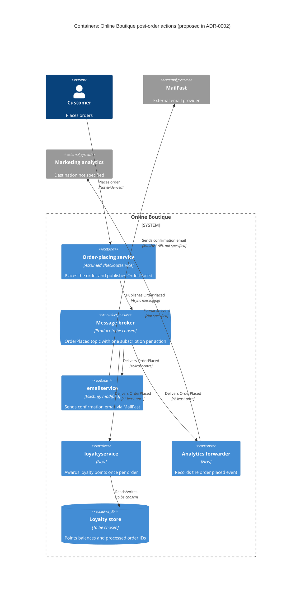

> Agent: Claude Code (VS Code extension) · Model: Claude Opus 5.5 (`claude-opus-5-5`) · run: a (zero-shot, `context: none`)

# ADR-0002: ใช้ event `OrderPlaced` ผ่าน message broker สำหรับงานหลังการสั่งซื้อ

- **Status:** Proposed
- **Date:** 2026-10-31
- **Deciders:** ยังไม่ระบุ (ดู Open questions ข้อ 12)

## Context and problem

ADR นี้เขียนจากข้อความ requirement เท่านั้น (`context: none`) ไม่ได้อ่านโค้ดหรือเอกสารของ Online Boutique ดังนั้นข้อความเกี่ยวกับระบบปัจจุบันจึงแยกประเภทไว้ดังนี้

| ข้อความ | ประเภท | ที่มา |
|---|---|---|
| หลังสั่งซื้อต้องส่งอีเมลยืนยันผ่าน MailFast (ผู้ให้บริการอีเมลภายนอกรายใหม่) แทน logic จำลองใน `emailservice` | Evidenced | requirement ข้อ 1 |
| ต้องให้ loyalty points ผ่าน `loyaltyservice` ซึ่งยังไม่มีและต้องสร้างใหม่ | Evidenced | requirement ข้อ 2 |
| ต้องบันทึก analytics event "order placed" ให้ทีม marketing | Evidenced | requirement ข้อ 3 |
| ปีหน้าจะมีงานหลังสั่งซื้อเพิ่ม (SMS, fraud scoring, อัปเดต recommendations) | Evidenced | requirement ย่อหน้าสุดท้าย |
| มี service หนึ่งที่ประสานขั้นตอนสั่งซื้อและเรียก `emailservice` แบบ synchronous (น่าจะเป็น `checkoutservice`) | Assumption | Not evidenced in the provided files |
| ระบบปัจจุบันยังไม่มี message broker | Assumption | Not evidenced in the provided files |
| คำสั่งซื้อถูกเก็บลงฐานข้อมูลหรือไม่ | ไม่ทราบ | Not evidenced in the provided files |

งานหลังการสั่งซื้อที่ต้องรองรับ:

| งาน | ปลายทาง | อยู่นอกระบบ? | ข้อกังวลหลัก |
|---|---|---|---|
| อีเมลยืนยันคำสั่งซื้อ | MailFast ผ่าน `emailservice` | ใช่ | เราควบคุม availability และ latency ของ MailFast ไม่ได้ |
| ให้ loyalty points | `loyaltyservice` (ใหม่) | ไม่ | ห้ามให้แต้มซ้ำหรือตกหล่น |
| analytics event "order placed" | ระบบ analytics ของ marketing (ไม่ระบุว่าคือระบบใด) | ไม่ทราบ | ไม่ระบุว่ายอมรับ delay หรือการสูญหายได้แค่ไหน |
| SMS, fraud scoring, recommendations (ปีหน้า) | ยังไม่ทราบ | ไม่ทราบ | จำนวนงานจะเพิ่มจาก 3 เป็นอย่างน้อย 6 |

**ปัญหา:** ขั้นตอนสั่งซื้อควรกระตุ้นงานหลังการสั่งซื้อเหล่านี้อย่างไร เพื่อให้
1. MailFast หรือ service ใหม่ที่ช้าหรือล่ม ไม่ทำให้การสั่งซื้อช้าลงหรือล้มเหลว และ
2. เพิ่มงานใหม่ในปีหน้าได้โดยไม่ต้องแก้ขั้นตอนสั่งซื้อทุกครั้ง

## Decision drivers

เรียงจากสำคัญที่สุด:

- **Modifiability (extensibility):** เพิ่มงานหลังสั่งซื้อใหม่ (SMS, fraud scoring, recommendations) โดยแก้ service ที่รับคำสั่งซื้อน้อยที่สุดหรือไม่แก้เลย
- **Availability ของการสั่งซื้อ:** MailFast, `loyaltyservice` หรือ analytics ล่ม ต้องไม่ทำให้ลูกค้าสั่งซื้อไม่ได้ [Assumption: การสั่งซื้อสำคัญกว่างานหลังสั่งซื้อ ต้องยืนยันกับ stakeholder]
- **Performance (checkout latency):** ไม่เพิ่ม latency ของการเรียกระบบภายนอกเข้าไปใน request ของลูกค้า (ยังไม่มีตัวเลขเป้าหมาย)
- **Reliability ของแต่ละงาน:** อีเมลและแต้มต้องไม่หาย และแต้มต้องไม่ถูกให้ซ้ำ
- **Interoperability / vendor isolation:** โค้ดเฉพาะของ MailFast อยู่ในที่เดียว เพื่อให้เปลี่ยนผู้ให้บริการได้ในอนาคต
- **Cost และภาระด้าน operation:** โครงสร้างพื้นฐานใหม่ต้องคุ้มกับประโยชน์ (งบประมาณและทักษะของทีมยังไม่ระบุ)

## Considered options

1. **A: Synchronous calls จาก service ที่รับคำสั่งซื้อ:** หลังชำระเงินสำเร็จ เรียก `emailservice` (ที่เปลี่ยนไปใช้ MailFast), `loyaltyservice` และ analytics ทีละตัวผ่าน RPC (เช่น gRPC หรือ HTTP)
2. **B: Event-driven publish/subscribe:** service ที่รับคำสั่งซื้อ publish event `OrderPlaced` ครั้งเดียวไปยัง message broker แต่ละงานเป็น subscriber อิสระที่มี queue/subscription ของตัวเอง
3. **C: Post-order orchestrator:** service ที่รับคำสั่งซื้อส่งงานแบบ asynchronous หนึ่งชิ้นไปยัง service ใหม่ (เช่น `postorderservice` หรือ workflow engine) ซึ่งเรียกแต่ละงานตามลำดับ พร้อม retry และเก็บสถานะของ workflow

### Pros and cons of the options

| Option | Pros | Cons |
|---|---|---|
| A | - ง่ายที่สุด ไม่ต้องมีโครงสร้างพื้นฐานใหม่ (cost) - ลำดับการทำงานชัด debug ง่าย (testability) - รู้ผลทันทีว่าส่งอีเมลหรือให้แต้มสำเร็จหรือไม่ (consistency) | - ทุกงานใหม่ต้องแก้และ deploy service ที่รับคำสั่งซื้อ (modifiability) - MailFast ช้าหรือล่ม ทำให้ checkout ช้าหรือล้ม หรือต้องเขียน timeout/retry เองทุกจุด (availability, performance) - latency สะสมตามจำนวนงาน 3 → 6+ (performance) - service ที่รับคำสั่งซื้อมี dependency เพิ่มขึ้นเรื่อยๆ (modifiability) |
| B | - เพิ่มงานใหม่ = เพิ่ม subscriber โดยไม่แก้ publisher (modifiability) - broker เก็บ message ไว้ระหว่างที่ consumer ล่ม แล้วส่งต่อภายหลัง (availability) - checkout รอแค่การ publish (performance) - แต่ละ consumer scale และ deploy ได้อิสระ (scalability, deployability) | - ต้องดูแล broker ตัวใหม่ ซึ่งกลายเป็นส่วนสำคัญของระบบ (cost, operability) - eventual consistency: อีเมลและแต้มมาถึงช้ากว่าการสั่งซื้อ (usability) - delivery แบบ at-least-once ทำให้ consumer ต้อง idempotent (reliability, ความซับซ้อนในการพัฒนา) - trace flow ข้าม service ยากขึ้น (observability, testability) - event schema กลายเป็น contract ร่วมของหลาย consumer (modifiability) |
| C | - logic และลำดับของงานหลังสั่งซื้ออยู่ที่เดียว เห็นสถานะของแต่ละคำสั่งซื้อ (observability) - รองรับลำดับขั้นและ compensation ได้ดี เช่น ถ้า fraud scoring ต้องยกเลิกคำสั่งซื้อ (reliability) - checkout ไม่ต้องรองานหลังสั่งซื้อ (performance) | - ทุกงานใหม่ยังต้องแก้ orchestrator (modifiability ด้อยกว่า B) - เพิ่ม service ศูนย์กลางตัวใหม่ และถ้าใช้ workflow engine ก็ต้องดูแลโครงสร้างพื้นฐานเพิ่ม (cost, availability) - ยังต้องมีกลไก async ระหว่าง checkout กับ orchestrator อยู่ดี (complexity) |

## Decision

เลือก **B: Event-driven publish/subscribe** ด้วย event `OrderPlaced`

เหตุผลเทียบกับ decision drivers:

- **Modifiability:** B เป็นทางเลือกเดียวที่การเพิ่ม SMS, fraud scoring หรือ recommendations ไม่ต้องแก้ทั้ง publisher และ service ศูนย์กลางใดๆ
- **Availability และ performance:** การสั่งซื้อขึ้นกับ broker เพียงตัวเดียว ไม่ขึ้นกับ MailFast หรือ service ใหม่
- **ไม่ต้องใช้ orchestrator (C):** งานทั้ง 3 ข้อในตอนนี้เป็นอิสระต่อกัน ไม่มีลำดับหรือ compensation [Inferred จาก requirement]

รายละเอียดของการตัดสินใจ:

| เรื่อง | การตัดสินใจ |
|---|---|
| Event | publish `OrderPlaced` ครั้งเดียวต่อคำสั่งซื้อ หลังคำสั่งซื้อสำเร็จ มี `event_id`, `order_id`, เวลา, `schema_version` และเฉพาะข้อมูลที่ consumer ต้องใช้ (เช่น รายการสินค้า ยอดรวม สกุลเงิน ช่องทางติดต่อลูกค้า) |
| `emailservice` | เปลี่ยนเป็น subscriber และ adapter ไปยัง MailFast โดยโค้ดเฉพาะ MailFast อยู่ใน service นี้เท่านั้น |
| `loyaltyservice` | subscriber ใหม่ idempotent โดยใช้ `order_id` เป็น key (ให้แต้มได้ครั้งเดียวต่อคำสั่งซื้อ) |
| Analytics | subscriber ใหม่ที่ส่งต่อ event ไปยังระบบของ marketing (ปลายทางยังไม่ระบุ) |
| Delivery | at-least-once, retry แบบ exponential backoff และ dead-letter queue แยกต่อ subscriber |
| การ publish ไม่ให้หาย | ใช้ transactional outbox ถ้า service ที่รับคำสั่งซื้อมีฐานข้อมูล ถ้าไม่มีต้องตัดสินใจเพิ่ม (Open questions ข้อ 2) |
| ผลิตภัณฑ์ broker | ไม่ตัดสินใน ADR นี้ ให้เลือกใน ADR ถัดไปตามทักษะของทีม platform และงบประมาณ (ตัวเลือกเช่น RabbitMQ, Apache Kafka, Google Cloud Pub/Sub) |

แผนภาพที่เสนอ (ชื่อ service ที่รับคำสั่งซื้อและ protocol ภายนอกเป็น Assumption):

## Consequences

- **Positive:**
  - เพิ่มงานหลังสั่งซื้อใหม่ได้ด้วยการเพิ่ม subscriber โดยไม่แก้ service ที่รับคำสั่งซื้อ (quality attribute: modifiability)
  - MailFast, `loyaltyservice` หรือ analytics ล่ม ไม่ทำให้การสั่งซื้อล้ม เพราะ message รอใน broker และ retry ภายหลัง (quality attribute: availability)
  - latency ของ checkout ไม่รวมเวลาเรียก MailFast และ service ใหม่ (quality attribute: performance)
  - โค้ดเฉพาะ MailFast อยู่ใน `emailservice` ที่เดียว ถ้าเปลี่ยนผู้ให้บริการก็แก้ service เดียว (quality attribute: modifiability, interoperability)
  - แต่ละ consumer scale ตามภาระของตัวเองได้ (quality attribute: scalability)
- **Negative:**
  - มี broker เป็นโครงสร้างพื้นฐานใหม่ที่ต้อง deploy, monitor และจ่ายค่าใช้จ่าย (quality attribute: cost, operability)
  - broker กลายเป็น dependency ใหม่ของการสั่งซื้อ (quality attribute: availability)
  - อีเมลและแต้มมาถึงหลังการสั่งซื้อไม่กี่วินาทีหรือนานกว่านั้น ลูกค้าอาจยังไม่เห็นแต้มทันที (quality attribute: usability, consistency)
  - ทุก consumer ต้อง idempotent และต้องมี correlation ID เพื่อ trace (quality attribute: reliability, observability, development effort)
  - event schema ต้องมีกฎการเปลี่ยนแปลงแบบ backward-compatible (quality attribute: modifiability)
  - ข้อมูลส่วนบุคคลใน event ถูกกระจายไปยัง consumer มากขึ้น (quality attribute: security, privacy)
- **Risks and mitigations:**

  | Risk | Mitigation |
  |---|---|
  | event หายระหว่างบันทึกคำสั่งซื้อกับ publish (dual write) | transactional outbox หรือ publish ซ้ำจนสำเร็จ ขึ้นกับว่าคำสั่งซื้อถูกเก็บที่ใด (Open questions ข้อ 2) |
  | ให้แต้มซ้ำเพราะ message ถูกส่งซ้ำ | `loyaltyservice` บันทึก `order_id` ที่ประมวลผลแล้วพร้อม unique constraint |
  | MailFast ล่มหรือจำกัด rate | retry แบบ backoff, circuit breaker, dead-letter queue และ alert |
  | message ที่ประมวลผลไม่ได้ (poison message) ค้าง queue | dead-letter queue แยกต่อ subscriber พร้อมเครื่องมือ replay |
  | broker ล่มทำให้ publish ไม่ได้ | outbox เก็บ event ไว้ก่อน หรือเลือก broker แบบ managed / HA ใน ADR ถัดไป |
  | fraud scoring ในปีหน้าต้อง *ขวาง* การยืนยันคำสั่งซื้อ ไม่ใช่งานหลังสั่งซื้อจริง | ถ้าเป็นเช่นนั้นต้องเป็นขั้นตอน synchronous ก่อน publish `OrderPlaced` หรือใช้ saga (option C) ให้ทบทวน ADR นี้ |
  | ทีมไม่มีประสบการณ์กับ message broker | เลือก broker แบบ managed และวางแผนฝึกอบรม (Open questions ข้อ 9) |
  | ส่งข้อมูลส่วนบุคคลไปยัง analytics โดยไม่จำเป็น | ใส่เฉพาะฟิลด์ที่จำเป็นใน event และให้ analytics forwarder ตัดข้อมูลส่วนบุคคลออกก่อนส่งต่อ |

## Validation

- **Load test:** วัด latency ของ checkout ก่อนและหลังเปลี่ยน ต้องไม่สูงกว่าเป้าหมาย (ตัวเลขยังไม่ระบุ, Open questions ข้อ 3)
- **Fault injection:** หยุด MailFast (ใช้ stub), `loyaltyservice` และ analytics ทีละตัว การสั่งซื้อต้องสำเร็จต่อไป และเมื่อกลับมาทำงานแล้ว message ต้องถูกประมวลผลครบ
- **Duplicate test:** ส่ง `OrderPlaced` เดียวกันซ้ำ ต้องได้แต้มเพียงครั้งเดียวและอีเมลเพียงฉบับเดียว
- **Metrics:** consumer lag, ขนาด dead-letter queue, อัตราส่งอีเมลสำเร็จของ MailFast, เวลาจากสั่งซื้อจนอีเมลถึง และจำนวนแต้มที่ให้ซ้ำ (เป้าหมาย = 0)
- **Modifiability check:** สร้าง subscriber ทดลอง (เช่น SMS stub) แล้วตรวจว่าไม่ต้องแก้ service ที่รับคำสั่งซื้อเลย
- **Review date:** ทบทวน ADR นี้ก่อนเพิ่มงานหลังสั่งซื้อตัวแรกของปีหน้า โดยเฉพาะ fraud scoring

## Open questions

1. service ใดรับคำสั่งซื้อ และปัจจุบันเรียก `emailservice` อย่างไร (synchronous หรือไม่ ใช้ protocol อะไร) — Not evidenced in the provided files
2. คำสั่งซื้อถูกเก็บลงฐานข้อมูลหรือไม่ (มีผลต่อการใช้ transactional outbox)
3. เป้าหมาย latency และ availability ของ checkout และปริมาณคำสั่งซื้อ (เฉลี่ยและช่วง peak) คือเท่าไร
4. MailFast มี API แบบใด, SLA, rate limit, ค่าใช้จ่ายต่ออีเมล, รองรับ idempotency key หรือ webhook แจ้ง bounce หรือไม่
5. อีเมลยืนยันต้องถึงลูกค้าภายในเวลาเท่าไร และถ้าส่งไม่สำเร็จต้องทำอะไร
6. loyalty points ต้องแสดงให้ลูกค้าเห็นทันทีหลังสั่งซื้อหรือไม่ (ยอมรับ eventual consistency ได้หรือไม่)
7. ทีม marketing ใช้ระบบ analytics ใด รับข้อมูลรูปแบบไหน และยอมรับการสูญหายหรือ delay ของ event ได้หรือไม่
8. fraud scoring ในปีหน้าเป็นงานหลังสั่งซื้อจริง หรือต้องขวาง/ยกเลิกคำสั่งซื้อได้ (มีผลต่อการเลือก B หรือ C)
9. ทีมมีทักษะกับ message broker ตัวใดบ้าง ระบบ deploy อยู่บน platform ใด และมีงบประมาณสำหรับ broker เท่าไร
10. ระบบปัจจุบันมี message broker อยู่แล้วหรือไม่
11. มีข้อกำหนดด้าน privacy หรือ consent อะไรบ้างสำหรับการส่งข้อมูลลูกค้าไปยัง MailFast และทีม marketing
12. ใครเป็น deciders ของ ADR นี้
